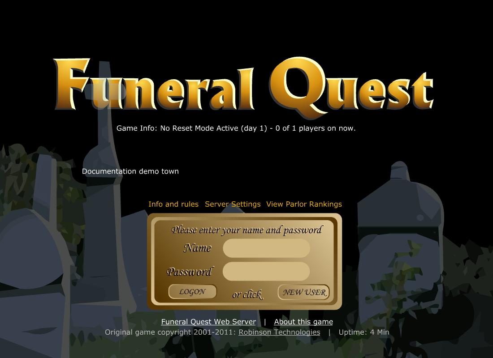
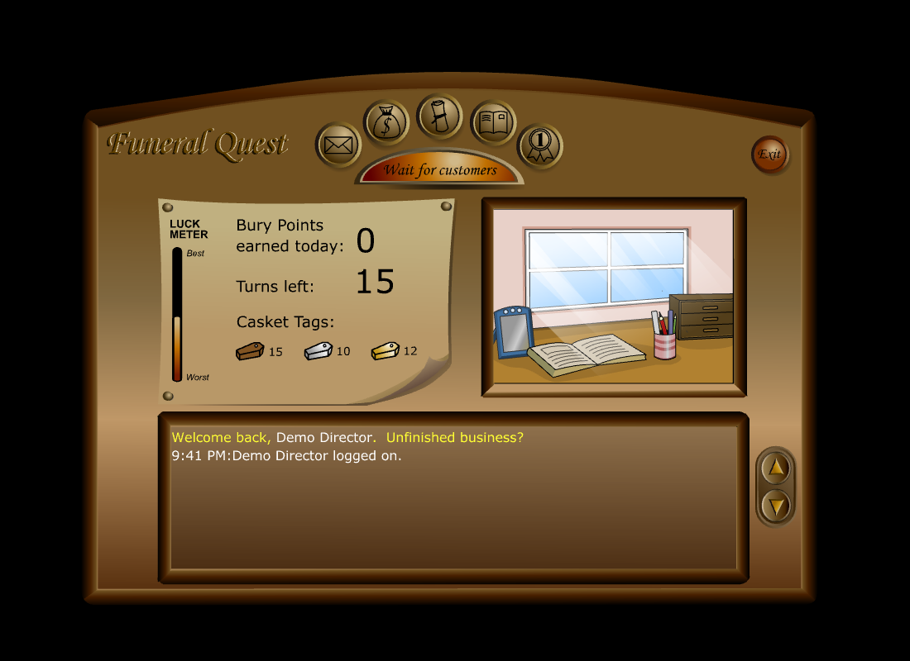
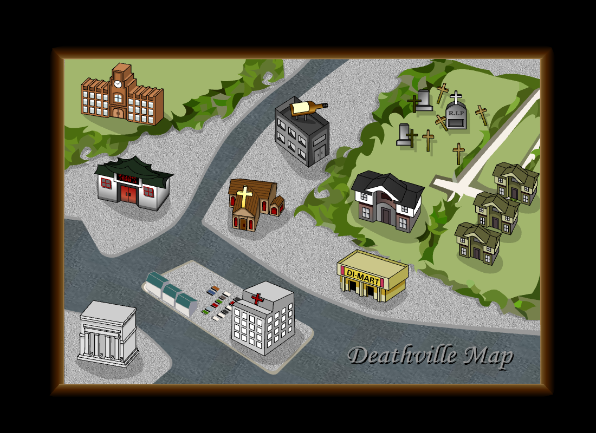
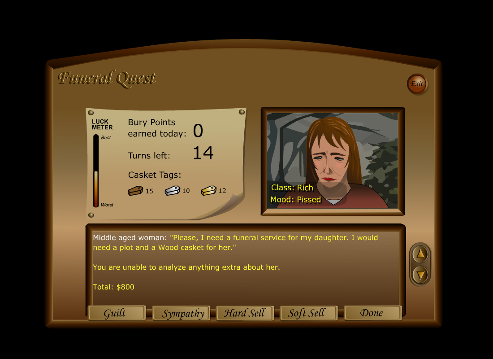

> **This copy (xerohour):** Mirror of [auzziejay/funeral-quest-web](https://github.com/auzziejay/funeral-quest-web) with the compiled `www/` package included — Flash client, Ruffle runtime, and game data are already packed in, so it deploys by uploading the contents of `www/` to any PHP 8.1+ host. First create `www/private/settings.local.php` from the example inside it and set your own operator password (10+ characters). Build verified 2026-10-20 (`npm run build:cpanel`; PHP protocol self-test and router smoke tests pass; client boots in Ruffle). The upstream README follows.

# Funeral Quest for PHP and cPanel

Run a Funeral Quest town on a PHP web host. Players use the original Flash client through the bundled Ruffle emulator in a modern browser. The server is a PHP reimplementation of the original game's HTTP protocol and rules.

**[Play the live demo](https://fq.usefulinternetco.com/)** · **[Original Funeral Quest source by Seth Robinson](https://github.com/SethRobinson/FuneralQuest)**

Funeral Quest is a daily-turn multiplayer game about competing funeral parlors. This port includes customers and sales pitches, tag exchanges, Di-Mart, Yang's, classes, hospital recovery, parlor break-ins and battles, mail, cafe chat, news, rankings, daily maintenance, tournaments, and an operator page. It also interprets the game's C-like scripts. Compatibility is covered by protocol tests; this is an evolving reimplementation, with no claim that every original behavior is identical.

## Screenshots

Captured from this PHP build using an isolated demonstration town and fictional accounts. Original artwork by Akiko Robinson.

| Login and server links | Your funeral parlor |
| --- | --- |
|  |  |

| Deathville town map | Customer sales |
| --- | --- |
|  |  |

## Start here

- **Hosting a town:** [cPanel installation, configuration, backups, and troubleshooting](docs/hosting.md).
- **Understanding the port:** [What comes from the original and what changed](docs/original-source.md).
- **Working on the code:** [Local development, tests, and repository layout](docs/development.md).

## Requirements

The **web host** needs PHP 8.1 or newer with JSON, iconv, password hashing, and file locking; Apache with `mod_rewrite` and `.htaccess` support; HTTPS; and a writable `private/data/` directory. No MySQL, Composer, or Node.js server is required. A dedicated domain or subdomain is supported; the client uses paths starting at `/`.

The **build computer** needs Git, Node.js with npm, and internet access to obtain the original assets and Ruffle. PHP CLI is needed for tests and local preview. The host only receives the prepared `www/` directory.

## Build the upload folder

Clone this repository and obtain the original game assets:

```sh
git clone https://github.com/auzziejay/funeral-quest-web.git
cd funeral-quest-web
git clone https://github.com/SethRobinson/FuneralQuest.git upstream
git -C upstream checkout f128dc2a15747f8a455485a74211ca6a0669c5fc
npm ci
npm run build:cpanel
```

The upstream revision above is the version used by this port. If `upstream/` already exists, use that checkout rather than cloning over it. The build copies the compiled game, scripts, help pages, Ruffle, and license notices into `www/`. It also patches the cafe chat display for Ruffle. Adobe Animate is not needed.

Before uploading, create `www/private/settings.local.php` using [the example](www/private/settings.local.example.php). Set the town's timezone and a unique operator password of at least 10 characters. The local settings file is ignored by Git.

Upload the **contents** of `www/` into the domain's document root, including both `.htaccess` files. Enable HTTPS and PHP 8.1+, check that `/private/` returns **403 Forbidden**, then open the domain. Follow the [hosting guide](docs/hosting.md) for the complete installation and cron setup.

## Admin login and server settings

1. In **cPanel File Manager**, open your game's document root, then `private/settings.local.php`. If it does not exist, copy `private/settings.local.example.php` to that name.
2. Set `admin_password` to your own password of **at least 10 characters**, then save the file. There is no built-in admin password.
3. Visit `https://YOUR-DOMAIN/admin.php`. Enter that password in **Operator password** and click **Log on**. No admin username is required; player accounts and cPanel credentials are separate.

The browser operator page manages players, online sessions, bans, logs, and maintenance. To change **server-wide settings** such as timezone, daily turns, town limits, tournament mode, or server news, edit their values in `private/settings.local.php` through cPanel File Manager and save. They take effect on the next PHP request. The operator page does not currently provide a server-settings editor, and the game's **Server Settings** link is a public, read-only information page.

See [admin access and settings instructions](docs/hosting.md#admin-login-and-server-settings) for the detailed steps, password recovery, and available controls. Keep the local configuration private and preserve it during updates.

## Preview and test locally

After building, with `php` on your PATH:

```sh
npm run test:php
npm run test:router
npm run dev:php
```

Open <http://127.0.0.1:8091/>. Local preview uses `www/router.php`; cPanel uses Apache and `.htaccess`. The PHP development server is for local use. `npm start` and `npm test` still run the earlier Node prototype; they do not run the cPanel version.

## Data and source

The PHP town is stored in `www/private/data/players.json`. **Keep the entire `private/data/` directory and `private/settings.local.php` when updating.** They contain player information and installation-specific configuration and must stay out of a public repository and downloadable release. The [hosting guide](docs/hosting.md#updates-and-backups) explains backups and restores.

The original checkout, generated assets, development tools, releases, local settings, and player data are ignored by Git. A new source checkout must run the build above before it can be uploaded. See [preparing a public repository](docs/development.md#preparing-a-public-repository).

## Credits and third-party terms

This product includes software written by Seth A. Robinson ( www.rtsoft.com ). Art by Akiko Robinson. Funeral Quest is copyright 2001 Robinson Technologies. Additional original design by Greg Smith.

Seth Robinson's [original repository](https://github.com/SethRobinson/FuneralQuest) supplies the game, artwork, scripts, and reference implementation. Its source uses the Proton SDK license. The author's README also releases the artwork under that license with credit to Akiko; its music and sounds are licensed only for Funeral Quest. Ruffle has its own MIT/Apache-2.0 terms. See [third-party notices](THIRD_PARTY_NOTICES.md) and [the source comparison](docs/original-source.md). This port's original contributions use the [MIT license](LICENSE); third-party material retains its existing terms.
